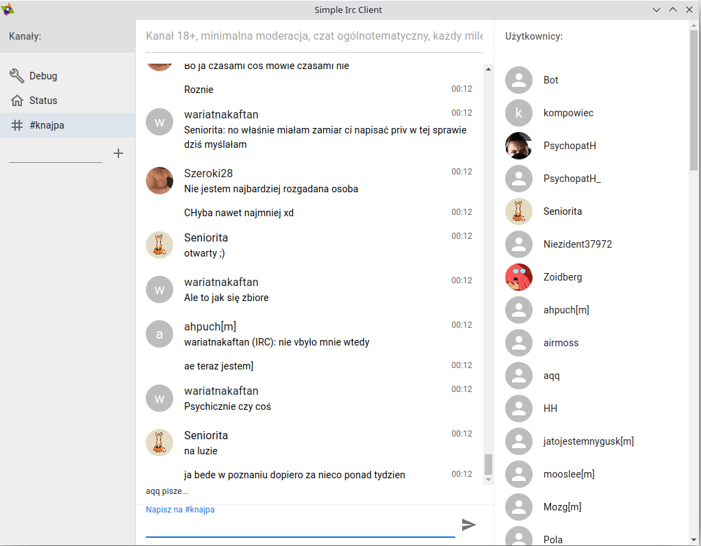

# Simple IRC Client 

A simple IRC client for the browser, Windows, macOS and Linux. Chat on Libera.Chat, OFTC or any other IRC network, with end-to-end encrypted private messages.

**[Open the web chat](https://app.simpleircclient.com/)** (no install, no account) or **[download the desktop app](https://github.com/Simple-Irc-Client/desktop/releases)**.

## Repositories

- [core](https://github.com/Simple-Irc-Client/core): the app
- [desktop](https://github.com/Simple-Irc-Client/desktop): desktop app for Windows, macOS and Linux
- [gateway](https://github.com/Simple-Irc-Client/gateway): server that connects the web chat to IRC
- [website](https://github.com/Simple-Irc-Client/website): [simpleircclient.com](https://simpleircclient.com)

## Contributing

Found a bug or have an idea? Open an issue or send a pull request.

## License

[AGPL-3.0](https://github.com/Simple-Irc-Client/desktop/blob/main/LICENSE). Authors: [Piotr Łuczko](https://www.github.com/piotrluczko), [Dariusz Markowicz](https://www.github.com/dmarkowicz).
